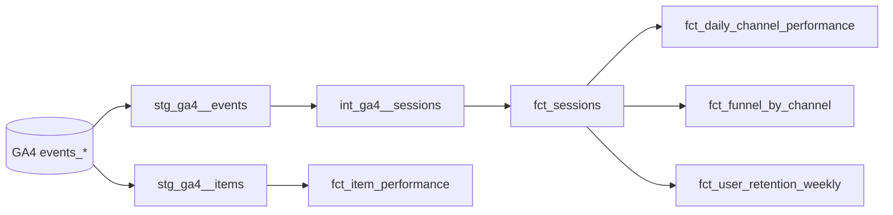

# GA4 E-commerce Analytics with dbt + BigQuery

A dbt project that turns raw Google Analytics 4 event data from the Google Merchandise Store
into tested, documented marketing tables: sessions, channel performance, purchase funnel,
product performance, and weekly retention.

**Data:** `bigquery-public-data.ga4_obfuscated_sample_ecommerce` (Nov 2020 – Jan 2021, ~4M events, free to query)
**Stack:** BigQuery · dbt Core · dbt_utils · Python (significance testing)

## Business questions

1. Which channels bring sessions that convert, and which only bring traffic?
2. Where in the funnel (view item → cart → checkout → purchase) do shoppers drop, and does it differ by device?
3. Which products get attention but don't sell?
4. How many new users come back in the following weeks?
5. Is the desktop vs. mobile conversion gap statistically real, and how large an A/B test would detect a lift?

## Lineage



| Layer | Model | Grain | Purpose |
|---|---|---|---|
| Staging | `stg_ga4__events` | event | Flattens nested `event_params` into columns, builds session key |
| Staging | `stg_ga4__items` | item × event | Unnests the `items` array for product analysis |
| Intermediate | `int_ga4__sessions` | session | Rolls events up to sessions: source, engagement, funnel flags, revenue |
| Mart | `fct_sessions` | session | Adds channel grouping; base for all session metrics |
| Mart | `fct_daily_channel_performance` | date × channel × device | Dashboard-ready KPIs |
| Mart | `fct_funnel_by_channel` | channel × device | Step counts and step-to-step conversion |
| Mart | `fct_item_performance` | item | Views, add-to-carts, units, revenue, conversion |
| Mart | `fct_user_retention_weekly` | cohort week × weeks since first visit | Retention curve |

## Metric definitions

| Metric | Definition |
|---|---|
| Session | Unique `user_pseudo_id` + `ga_session_id` |
| Engaged session | GA4 `session_engaged = 1` (10s+, a conversion event, or 2+ page views) |
| Session conversion rate | Sessions with ≥1 `purchase` event ÷ all sessions |
| Average order value | Purchase revenue ÷ distinct transaction IDs |
| Revenue per session | Purchase revenue ÷ sessions |
| Channel group | Simplified GA4 default grouping from the session's first source/medium (`macros/channel_group.sql`) |
| Retention (week n) | Users active in cohort week + n ÷ users first seen in the cohort week |

## Data quality tests

`dbt build` runs 24 tests, including:

- Primary keys are unique and not null (`fct_sessions`, `fct_item_performance`, marts' composite keys)
- Channel groups and device categories only take expected values
- Rates fall between 0 and 1, revenue is never negative
- **Reconciliation:** total revenue in `fct_sessions` matches purchase revenue in raw events (`tests/assert_revenue_reconciles_to_events.sql`)
- **Reconciliation:** item-level revenue matches session-level revenue within 0.5% (`tests/assert_item_revenue_reconciles_to_sessions.sql`)
- **Logic check:** week-0 retention is always 100% (`tests/assert_week0_retention_is_100pct.sql`)

## Design decisions

- **Staging is materialized as tables** so the sharded raw data is scanned once per run; everything downstream reads the smaller staging tables.
- **Date range is a variable** (`start_date`, `end_date`), so development runs can use a few days of data: `dbt build --vars '{start_date: "20201201", end_date: "20201207"}'`.
- **Event-scoped source/medium first, user first-touch as fallback.** The export's `traffic_source` field is the user's *first-ever* source, which misattributes returning sessions.
- **Obfuscated values get their own channel bucket** (`'<Other>'`, `'(data deleted)'`) instead of being silently lumped into "Other".
- **Funnel steps are "reached in session", not strictly ordered**, because GA4 doesn't guarantee every step event fires (e.g., purchase without begin_checkout).

## How to run

1. Create a Google Cloud project (the free [BigQuery sandbox](https://cloud.google.com/bigquery/docs/sandbox) is enough).
2. Install and authenticate:
   ```bash
   pip install dbt-bigquery
   gcloud auth application-default login
   ```
3. Copy `profiles.example.yml` to `~/.dbt/profiles.yml` and set your project ID.
4. Build and test:
   ```bash
   dbt deps
   dbt build            # runs models + tests
   dbt docs generate && dbt docs serve   # browse docs and the lineage graph
   ```
5. Significance analysis:
   ```bash
   pip install google-cloud-bigquery pandas db-dtypes
   python notebooks/conversion_significance.py --project YOUR_GCP_PROJECT_ID
   ```

## Findings

Full run: Nov 2020 – Jan 2021, **360K sessions, 4,848 converting sessions, $362K revenue, 1.35% session conversion.**

**1. Referral traffic is the most valuable channel.** It drives 19.5% of sessions but 31% of converting sessions,
converting at 2.15% vs. 1.27% for Organic Search (1.7×, z ≈ 15). Its checkout-to-purchase rate is 55% vs. 38–40% for Organic.

**2. Direct traffic converts suspiciously poorly (0.51%).** Only 27% of Direct checkouts complete, vs. 55% for Referral.
Direct usually converts *above* average, so this points to untracked or low-quality sessions landing in the Direct bucket.
Next checks: tagging coverage on landing pages and the share of zero-engagement Direct sessions.

**3. Paid Search underperforms.** 3.3% of sessions but 1% of converting sessions, at 0.39% conversion, under a third of Organic.
The dataset has no ad spend, so ROI can't be calculated, but the channel warrants a review.

**4. Email is small but converts at 11.7%** (197 sessions). The sample is too small for a precise rate, but it points to email as an
under-used re-engagement channel, which matters given finding 6.

**5. The biggest funnel drop is product view → add to cart (18–21% across channels).** Ten high-traffic products had
600–3,000 views each and zero sales, e.g. *Google Tracking Hat* (2,893 views, 0 add-to-carts), which suggests availability or listing issues.

**6. Retention is low:** 4.8% of new users return the next week and 1.2% by week 4. This is typical of an infrequent-purchase merch store.
(Simple average across weekly cohorts; later weeks include fewer cohorts.)

**7. Mobile vs. desktop: statistically significant, practically irrelevant.** Mobile converts at 1.39% vs. desktop 1.32%
(z = −1.96, p = 0.0497), a 0.08-point gap too small to act on. This contradicts the common assumption that mobile converts worse.

**8. A/B test sizing.** At ~3,900 sessions/day and a 1.3% baseline, detecting a 20% conversion lift needs ~32K sessions per arm
(~2.5 weeks); a 10% lift needs ~124K per arm (~2 months); a 5% lift needs ~483K per arm (~8 months). Smaller changes should be
tested on a higher-frequency metric such as add-to-cart rate.

**Data quality notes**
- Item revenue reconciles to session revenue within 0.02% ($362,110 vs. $362,165). Purchases join back to products correctly.
- 2.8% of purchase item rows have no item ID.
- 24% of sessions fall into an "Obfuscated" channel because Google masks some sources in this public sample.
